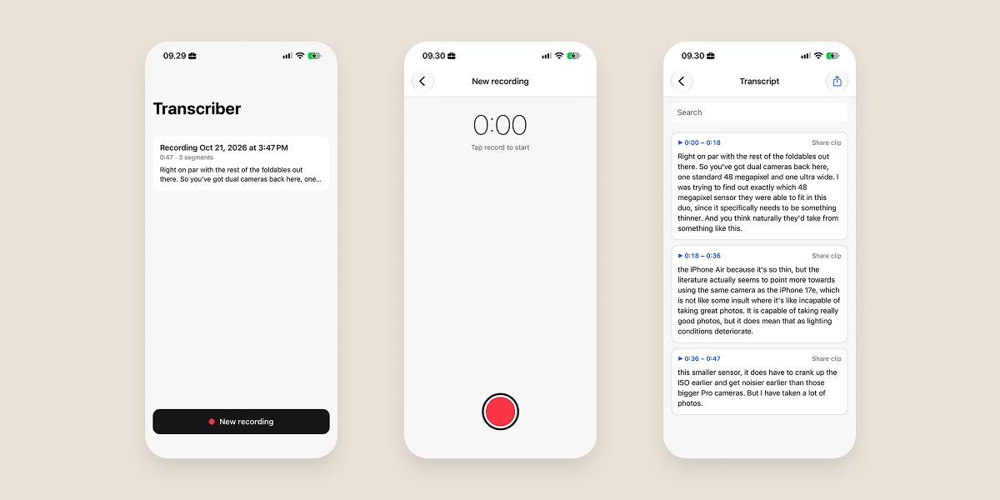

[](https://discord.gg/qhaMc2qCYB)
[](https://matrix.to/#/#nobodywho:matrix.org)
[](https://mastodon.gamedev.place/@nobodywho)
[](https://docs.nobodywho.ooo)

# Transcriber app

Demonstrates the capabilities of **[NobodyWho](https://github.com/nobodywho-ooo/nobodywho)**, a library designed to run LLMs locally and efficiently on any device. With this app, you can do transcription locally, offline and for free, thanks to whisper Speech to Text model.

## Step 1: Install and Start Metro

First, you will need to run install dependencies:

```sh
npm install
```

To start the Metro dev server, run the following command :

```sh
npm start
```

## Step 2: Build and run your app

### Android

```sh
npm run android
```

### iOS

For iOS, remember to install CocoaPods dependencies (this only needs to be run on first clone or after updating native deps).

The first time you create a new project, run the Ruby bundler to install CocoaPods itself:

```sh
bundle install
```

Then, and every time you update your native dependencies, run:

```sh
bundle exec pod install
```

For more information, please visit [CocoaPods Getting Started guide](https://guides.cocoapods.org/using/getting-started.html).

```sh
npm run ios
```

You can also build it directly from Android Studio or Xcode.
